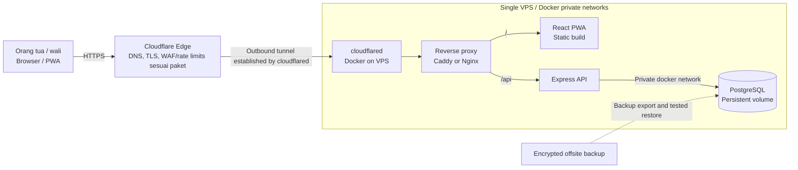
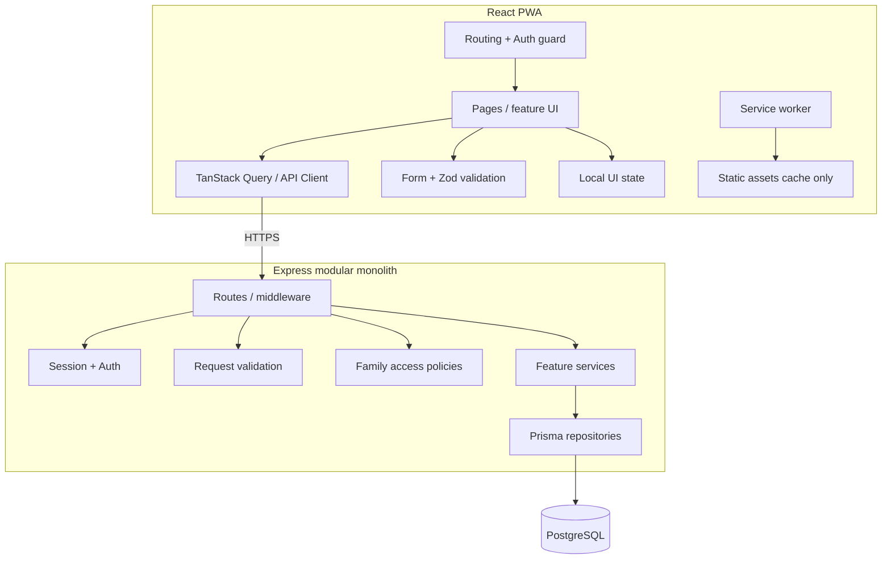
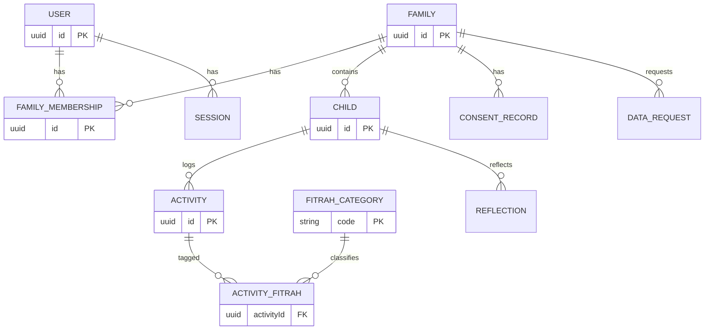
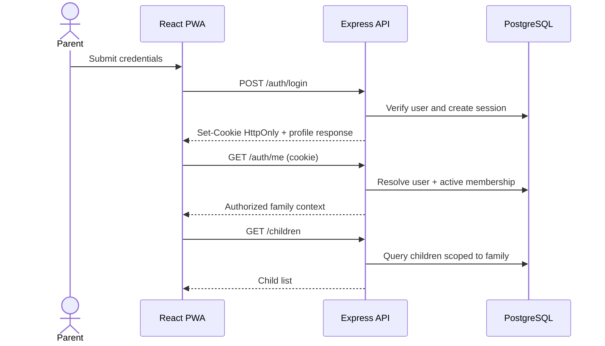
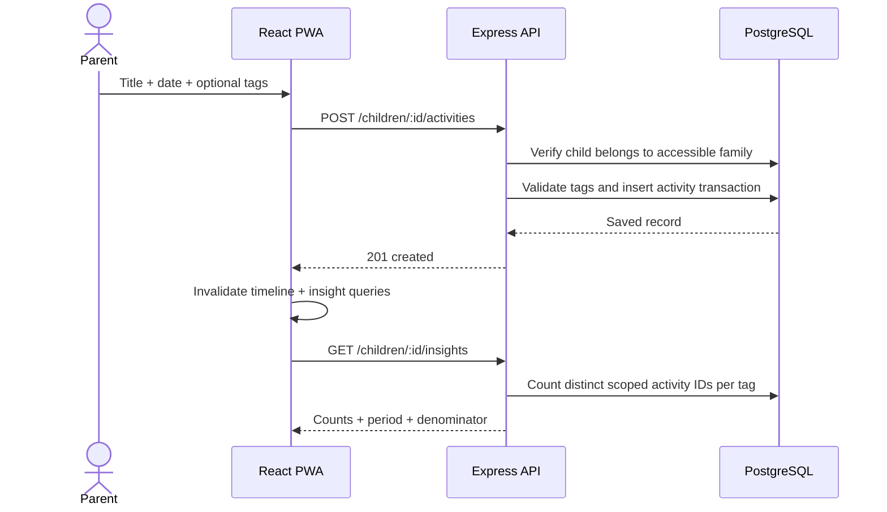
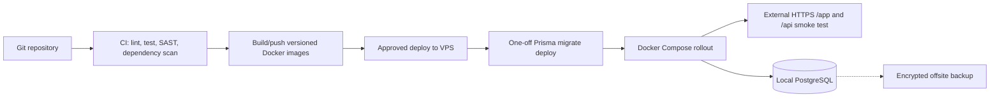

# Software Architecture Document (SAD) — Filio

**Versi:** 1.2 — Proposed Architecture / Review Draft  
**Tanggal:** 1 November 2026  
**Status:** Usulan arsitektur; menunggu audit repository, review keamanan, dan persetujuan product owner  
**Sumber kebutuhan:** `prd_filio.md`, `Filio_BRD_v2.md`, `Filio_PRD_v2.md`, dan keputusan diskusi **web-first: React PWA menggantikan React Native sebagai frontend utama**, serta **seluruh aplikasi berjalan pada VPS dengan PostgreSQL self-hosted dan Cloudflare Tunnel sebagai jalur publikasi (tanpa Neon/Cloud Run pada target produksi)**.  
**Audiens:** Product owner, tech lead, software engineer, AI coding agent, QA, DevOps, security reviewer.

> **Klasifikasi fakta:** Bagian **As-Is** bersumber dari PRD awal, bukan verifikasi kondisi repository/production. Bagian **To-Be** adalah usulan keputusan arsitektur dan belum berarti sudah diimplementasikan. Tidak ada audit source code, database, CI/CD, cloud configuration atau penetration test dalam penyusunan SAD ini.

---

## 1. Tujuan dan batas dokumen

SAD ini menjelaskan konteks sistem, keputusan arsitektur, komponen, keamanan, pemodelan data, integrasi, deployment, quality attributes, strategi migrasi, serta pengujian untuk Filio. Dokumen ini **bukan** pengganti BRD/PRD, desain UI detail, runbook operasional, ataupun hasil audit kode. Persyaratan produk tetap mengacu pada PRD v2 sampai PRD diperbarui secara formal untuk perubahan platform.

**Business goals:** (1) mempercepat eksperimen UX/produk; (2) mengurangi hambatan akses melalui URL dari komunitas; (3) menjadikan jurnal, inspirasi, dan refleksi pengasuhan praktis; (4) memprioritaskan privasi data anak; (5) menjaga fleksibilitas untuk fitur native bila dibuktikan diperlukan.

**Non-goals MVP:** aplikasi native di store, komunitas publik yang menyajikan data anak, skor klinis perkembangan anak, model AI yang memproses jurnal anak, pembayaran, dan sinkronisasi offline lengkap. Dukungan installable/offline app shell **bukan** komitmen bahwa semua operasi dapat berjalan offline.

## 2. Baseline As-Is dan gap validasi

| Area | Kondisi berdasarkan PRD awal (belum diaudit) | Target To-Be |
|---|---|---|
| Frontend | React Native + Expo, APK EAS belum rilis | React + TypeScript + Vite, mobile-first PWA |
| Backend | Node.js + Express.js pada Cloud Run menurut PRD awal | **Express API container pada VPS yang sama** dengan frontend dan PostgreSQL; Cloud Run dihentikan setelah cutover |
| Data | PostgreSQL pada Neon, Prisma ORM (menurut PRD awal) | **PostgreSQL self-hosted di VPS**, private Docker network + Prisma; migrasi dari Neon hanya jika data aktual ada |
| Auth | JWT Bearer, password bcrypt | Prefer server-managed revocable web session melalui Secure/HttpOnly cookie; strategi transisi dari Bearer |
| Delivery | Docker, GitHub CI/CD; `prisma migrate deploy` via entrypoint | **Docker Compose pada VPS**, image build melalui CI, deployment terkontrol, migrasi DB via one-off job |
| Fungsional selesai menurut checklist | Registrasi/login, CRUD anak, jurnal multi-tag, progress bar | Reimplementasi frontend dengan parity fungsional dan revisi terminologi metrik |
| Fitur roadmap | Undang pasangan, radar chart, foto, AI, notifikasi | Iterasi bertahap sesuai BRD/PRD v2 dan penilaian risiko |

**Audit wajib sebelum pelaksanaan:** struktur repository; source-of-truth schema Prisma; bentuk JWT dan masa berlaku; hosting dan domain backend; CORS saat ini; pola query authorization; struktur route/response; kode yang dapat direuse; logging; environment secrets; backup restore; staging; status regulasi PSE/privasi; dan estimasi migration effort. Jangan menganggap checklist PRD membuktikan production readiness.

## 3. Keputusan arsitektur (ADR summary)

| ID | Keputusan | Alasan | Trade-off / kondisi evaluasi |
|---|---|---|---|
| ADR-001 | **Web-first React PWA** sebagai frontend utama | Iterasi cepat, URL onboarding, satu web experience responsif | Native lebih unggul untuk background tasks/integrasi OS; evaluasi kembali berbasis kebutuhan dan telemetry |
| ADR-002 | React + TypeScript + Vite SPA | Produk dominan authenticated, SSR tidak wajib pada MVP | SEO public content kelak dapat memakai situs terpisah atau mempertimbangkan SSR |
| ADR-003 | Modular monolith Express API | Memanfaatkan backend berjalan dan meminimalkan operations overhead | Hindari microservices hingga ada kebutuhan skala/organisasi |
| ADR-004 | **PostgreSQL self-hosted di VPS + Prisma; hentikan Neon** | Kontrol data dan operasional DB pada infrastruktur sendiri | Tim bertanggung jawab atas hardening VPS, backup terpisah, patching, pemulihan, dan availability provider |
| ADR-005 | **Private by default; family-scoped authorization** | Data keluarga/anak sensitif | Semua endpoint perlu kontrol server-side, tidak mengandalkan UI/token claims saja |
| ADR-006 | Prefer revocable web session via `HttpOnly; Secure; SameSite` cookie | Tidak mengekspos access credential ke browser storage | Perlu proteksi CSRF, session store/DB, dan penataan domain |
| ADR-007 | MVP PWA **online-first**, cache app shell/static assets | Minimalkan kerumitan sync serta paparan data anak pada device bersama | Draft offline terbatas hanya setelah threat modeling dan uji UX |
| ADR-008 | **Frontend, API, PostgreSQL, reverse proxy dan cloudflared pada satu VPS**, dipublikasikan dengan Cloudflare Tunnel | Sederhana untuk MVP; satu origin dan database tidak terekspos | Single point of failure; wajib backup offsite, monitoring, dan prosedur recovery |
| ADR-009 | Metrics transparan sebagai **catatan aktivitas**, bukan skor anak | Menghindari interpretasi klinis/kompetitif | Perlu perubahan label grafik dan komunikasi pengguna |
| ADR-010 | Hindari migrasi Prisma via container entrypoint multipod | Risiko race dan deployment gagal | Jalankan dedicated migration job sebelum app release dengan backup/rollback plan |

### Alternatif yang ditolak sementara

- **Expo Web**: cepat memanfaatkan kode RN tetapi membawa adapter UI dan dependency Expo yang tidak diperlukan bagi web-first; audit code reuse bisa mengubah keputusan.
- **Dual React Native + PWA**: menambah testing/maintenance dua UI sebelum validasi pasar.
- **Next.js**: masuk akal jika SEO, server rendering, dan public content menjadi prioritas; belum kebutuhan inti MVP.
- **Microservices**: overhead terlalu tinggi untuk scope dan ukuran tim MVP yang belum divalidasi.

## 4. Konteks sistem dan trust boundaries



**Keputusan topologi:** Semua komponen aplikasi produksi **berjalan di VPS**. Cloudflare Tunnel adalah **jalur masuk dari internet ke HTTP reverse proxy**, **bukan koneksi database** dan **bukan hosting**. VPS membuat koneksi keluar lewat `cloudflared`; tidak diperlukan inbound publik untuk HTTP/HTTPS pada origin. Jangan publikasi port 5432, 3000/API, atau port internal reverse proxy langsung ke internet. SSH admin hanya melalui akses privat/Cloudflare Access/WARP atau jalur manajemen yang dibatasi secara ketat.

**Public hostname:** `app.<domain-filio>` sebagai contoh. Reverse proxy melayani `/` (PWA) dan `/api` (API) di **origin yang sama**, mempermudah cookie session dan mengurangi CORS. Domain aktual ditentukan pada provisioning.

**Trust boundaries:** (1) browser dan setiap permintaan publik tidak dipercaya; (2) Cloudflare Edge dan tunnel tidak menggantikan authentication/authorization aplikasi; (3) akses API ke data wajib dibatasi membership keluarga; (4) database hanya menerima trafik dari container API/pekerjaan migrasi pada private Docker network; (5) akses operator dan backup dibatasi, diaudit, dienkripsi.

**Cloudflare Access:** tepat untuk staging, admin, dan panel operasional. **Jangan wajibkan Cloudflare Access untuk pengguna publik Filio** bila onboarding orang tua mengharuskan daftar/login normal; gunakan autentikasi Filio sendiri, rate limits, WAF dan anti-abuse. Tunnel tanpa kebijakan Access tetap membuat aplikasi **publik di internet**.

## 5. Container / module architecture



**Backend modules:** `auth`, `families`, `children`, `activities`, `fitrah-taxonomy`, `insights`, `privacy-data-rights`, `activity-ideas` (P1), `reflections` (P1), `family-invitations` (V1.1), `media` (V1.1). Cross-cutting: error handler, logging redaction, rate limiting, input schema, audit event, request ID.

**Frontend routes (usulan, bukan kontrak implementasi):** `/login`, `/register`, `/app`, `/app/children/:id`, `/app/children/:id/activities`, `/app/activities/new`, `/app/ideas`, `/app/reflections`, `/app/settings/privacy`. Deep links perlu SPA fallback dari hosting.

**Frontend layering:** components UI yang presentasional → hooks feature/query → typed API client → server. Jangan menaruh business rules keamanan di browser; UI permissions hanya untuk experience.

## 6. Technology baseline

| Concern | Pilihan | Catatan |
|---|---|---|
| UI/build | React, TypeScript, Vite | Lock versions setelah audit compatibility |
| Styling/components | Tailwind CSS, shadcn/ui | Aksesibilitas keyboard, touch targets, mobile layout |
| Routing | React Router | Browser history fallback |
| Server state | TanStack Query | Tidak persist response jurnal secara default |
| Form | React Hook Form + Zod | Validasi ulang pada API |
| PWA | vite-plugin-pwa / Workbox | Precaching hashed assets, exclude API/private data |
| Offline | browser cache app shell; optional IndexedDB for draft | Draft anak hanya dengan explicit opt-in dan expiry, jika disetujui |
| API | Express + Node.js | Modular monolith, REST/JSON, versioned contracts |
| ORM/database | Prisma + PostgreSQL self-hosted di VPS | Volume persistent, image versi pinned, network privat, backup offsite, least privilege |
| Backend host | VPS Docker Compose | Satu VPS untuk MVP, kontainer API terisolasi dari database dan edge |
| Frontend host | VPS container static server / reverse proxy | Build React disajikan melalui hostname tunggal pada Cloudflare Tunnel |
| CI/CD | GitHub-based pipeline existing (klaim PRD) + VPS deployment | Deploy pinned images via SSH/runner secure; jangan expose Docker socket |
| Monitoring | structured application logs + metrics/error tracking | Redact PII, no child photos/notes in observability |

## 7. Data architecture

### 7.1 Domain model target



**As-Is** PRD awal menggunakan `User.familyId`; **To-Be** mengusulkan `FamilyMembership` sebagai basis membership agar undangan pasangan dan lebih dari satu keluarga tidak memerlukan perombakan besar. Tabel boleh ditunda jika risiko migrasi tinggi, tetapi desain authorization perlu mengantisipasi perubahan ini.

### 7.2 Entitas inti dan batasan data

| Entitas | Field penting (usulan) | Aturan |
|---|---|---|
| `User` | `id`, `email`, `passwordHash`, `displayName`, timestamps | Email normalized unique, password never logged |
| `Family` | `id`, `name`, timestamps | Data anak dimiliki keluarga, bukan globally discoverable |
| `FamilyMembership` | `familyId`, `userId`, `role`, `status`, timestamps | Unique `(familyId,userId)`; backend-only authorization |
| `Child` | `id`, `familyId`, `nickname`, `dateOfBirth?`, timestamps | Data minimal; age-aware recommendations only if required |
| `Activity` | `id`, `childId`, `title`, `description?`, `activityDate`, `createdBy`, timestamps | `activityDate` local calendar date, audit actor |
| `FitrahCategory` | `code`, `label`, `description`, `taxonomyVersion`, `active` | 8 kategori dari PRD awal; editorial review sebelum rilis |
| `ActivityFitrah` | `activityId`, `fitrahCode` | Unique pair; no duplicate tagging |
| `Session` | `id`, `userId`, `tokenHash`, `expiresAt`, `revokedAt`, device metadata minimal | Revocable, opaque token stored hashed at rest |
| `ConsentRecord` | `familyId`, `actorId`, `purpose`, `noticeVersion`, `timestamp` | Necessary vs optional choices separated |
| `DataRequest` | `familyId`, `requesterId`, `type`, `status`, timestamps | Export/delete workflow, verify ownership |
| `Reflection` | `childId`, `promptVersion`, `text?`, timestamps | P1; private and optional |

**8 taxonomy categories per original PRD:** Keimanan, Belajar, Bakat, Seksualitas, Estetika, Sosial, Jasmani, Perkembangan. Kategori adalah konsep interpretatif dari produk, bukan penilaian klinis. Tata nama, definisi, dan contoh memerlukan editorial review. Hindari menyimpulkan diagnosis atau kualitas anak dari tag counts.

**Privacy by design:** minimum fields; tidak ada lokasi presisi wajib; akun anak dan public profiles tidak tersedia; foto bukan kebutuhan P0. Definisikan retention, backup purge, export format, soft-vs-hard delete, consent lifecycle di kebijakan operasional sebelum publikasi.

### 7.3 Analytics semantics

- `recorded_activity_count`: distinct `Activity.id` per child/periode.
- `category_activity_count`: distinct activities carrying that tag; satu aktivitas bisa masuk beberapa kategori sehingga total antar-kategori **dapat melebihi** total aktivitas.
- `untagged_activity_count`: aktivitas tanpa tag.
- Jika ditampilkan persentase: denominator **jumlah aktivitas tercatat** periode itu; label **“% aktivitas tercatat yang memuat kategori”**, **bukan** persen perkembangan dan kategori tidak wajib berjumlah 100%.
- `N=0` → empty state netral, tidak memberi skor nol anak. Tidak menggunakan score target/traffic-light yang mengindikasikan keterlambatan perkembangan.
- Semua pemfilteran wajib scoped ke family dan child berizin; hindari tracking raw journal text ke produk analytics pihak ketiga.

## 8. API design (logical contract, to be verified)

Prefix usulan: `/api/v1`; response JSON; error envelope konsisten (`code`, `message`, `requestId`), field-level validation errors; timestamps ISO 8601 UTC, activity date `YYYY-MM-DD` dibaca sebagai kalender lokal, bukan timezone-shifted timestamp.

| Verb | Endpoint | Scope dan perilaku |
|---|---|---|
| POST | `/auth/register` | Buat user+family transactionally |
| POST | `/auth/login` | Set secure session cookie; throttling |
| POST | `/auth/logout` | Revoke session; clear cookie |
| GET | `/auth/me` | Identitas dan authorized family membership |
| GET/POST | `/children` | List/create dalam family aktif yang diotorisasi |
| GET/PATCH/DELETE | `/children/:id` | Ownership check server-side |
| GET/POST | `/children/:id/activities` | Pagination, validation, ownership |
| GET/PATCH/DELETE | `/activities/:id` | Child→family authorization; mutation permissions |
| GET | `/fitrah/categories` | Curated taxonomy version |
| GET | `/children/:id/insights?from=&to=` | Counts with explicit denominator and data completeness |
| GET | `/activity-ideas` | P1 curated ideas, no personal exposure |
| GET/POST | `/children/:id/reflections` | P1, private |
| POST | `/privacy/exports` | Async/request workflow, verify identity |
| POST | `/privacy/deletion-requests` | Safe irreversible request/confirmation |

**Important:** URI/field names are *proposed*. Map existing API endpoints and provide adapter compatibility during migration; do not force breaking route changes merely for convention.

### Example authorization pseudo-flow

```text
requireAuthenticatedSession(request)
child = db.child.findUnique(childId)
if child is missing: return 404
membership = db.familyMembership.findActive(userId, child.familyId)
if membership missing or permission disallowed: return 404 or 403 per disclosure policy
perform operation with childId AND authorized family scope
```

Avoid trusting `familyId` from URL/body for tenant access. Mutation operations should enforce permissions, and all list queries should be filtered at database level. Add automated IDOR tests across at least two families.

## 9. Authentication, security, dan privacy

### 9.1 Browser authentication target

Recommended design: browser holds **opaque, revocable session ID** in `__Host-` (same-origin) cookie configured `Secure`, `HttpOnly`, and `SameSite=Lax` or `Strict` after evaluating login flow; backend stores **hash** of session token with expiry/revocation. Prefer reverse proxy to present `/api` same-origin. If architecture uses separate origins/subdomains, verify exact cookie scope and credential behavior with browser testing. Do not put JWT/refresh token in `localStorage` or `sessionStorage`.

CSRF: apply synchronizer token or robust origin verification (as appropriate to API model) to state-changing requests, along with SameSite protection; CORS explicit allowlist; `credentials: include` where needed. Rotate session at login/elevation, throttle failed auth, protect password reset, logout all sessions when necessary.

**Transition from legacy Bearer JWT:** first add server session capabilities; support current clients during controlled overlap; migrate login/frontend; monitor; revoke/remove deprecated auth routes after parity. Never silently change authentication contract and break production client.

### 9.2 Controls baseline

- HTTPS/TLS everywhere; HSTS after domain readiness.
- Password hash with current vetted parameters and safe verification; existing bcrypt hashes remain verifiable through migration.
- Secrets in managed secret store, no plaintext in repo/browser bundles; secret rotation procedure.
- Validate and normalize all inputs at server, limit body size, output encoding, Content Security Policy, secure headers, dependency scanning.
- RBAC + tenant resource policies; no broad public file URLs. Audit events for auth, privacy exports/deletes, invitations, permissions changes; exclude private content.
- Rate limits for auth, write routes, export and reset flows; abuse monitoring.
- Backups encrypted, recovery tested, least-privilege DB role, no production data in local development.
- Data subject requests / lawful basis, age-appropriate access, parent/guardian authority, processor agreements and cross-border transfer review before rollout.

**Indonesia legal checkpoint:** UU No. 27 Tahun 2022 tentang Pelindungan Data Pribadi, PP No. 17 Tahun 2025 mengenai tata kelola PSE dalam pelindungan anak, dan Permenkomdigi No. 9 Tahun 2026 sebagai regulasi pelaksana relevan untuk ditinjau bersama penasihat hukum. Applicability bergantung model layanan, fitur, dan profil pengguna; SAD ini bukan legal opinion.

### 9.3 PWA caching policy

- Precache **only** versioned JS/CSS/fonts/icons/static offline page; runtime cache untuk public non-sensitive content bila dibutuhkan.
- **Never cache:** `/api/**` responses berisi identitas/jurnal/refleksi, auth responses, child photos, signed file URLs; mark private responses `Cache-Control: no-store`.
- Browser back navigation/logout must not reveal stale private content in app state; clear in-memory TanStack Query cache on logout/account switching and on session expiration.
- No plaintext journaling data in service-worker cache. Offline draft via IndexedDB **deferred** until privacy controls and retention/clear flow are defined; notify users that device/browser storage can be cleared.
- Service-worker update UX: notify on new version; avoid silently wiping unsaved input; test navigation fallback and deployments.

## 10. Core sequences

### 10.1 Login and load dashboard



### 10.2 Save activity and update insight



## 11. Deployment topology and CI/CD — target VPS + Cloudflare Tunnel



**Deployment strategy:** deploy application images with immutable version tags, update Compose after approval, run one-off migration against an isolated/verified DB backup, then update API and static frontend. Avoid `prisma migrate deploy` on every container start. Run backups/restores and release health checks before cutover. Rollback API/frontend with previous image tags; database migrations must be backward compatible.

**Recommended containers:** `cloudflared`, `reverse-proxy` (Caddy/Nginx), `web` (static PWA serving), `api` (Express), `db` (PostgreSQL). `backup` may be a scheduled job outside Compose. Use networks `edge` (cloudflared ↔ reverse proxy), `app` (proxy ↔ web/API), `data` (API ↔ DB); attach only needed containers to each network. `db` should have **no `ports` mapping** and should have dedicated persistent volume. API should have **no host-public port**. Containers must have health checks, resource limits, log rotation and restart policy.

**Operational baseline:** provision VPS with OS auto security updates as appropriate, SSH key and MFA on provider account, least-privilege user and firewall deny inbound by default. Restrict tunnel credentials/Cloudflare API tokens as secrets; rotate if compromised; never commit them to repository. Cloudflare dashboard tunnel route maps `app.<domain>` to reverse-proxy service reachable from the `cloudflared` container. When run in Compose, use Docker service DNS; **do not use `localhost` to refer to another container**.

**TLS and headers:** browser ↔ Cloudflare HTTPS mandatory; tunnel uses authenticated encrypted connectivity. Internal service HTTP inside one-host Docker networks can be acceptable for MVP if host isolation is trusted, subject to security review. Configure trusted proxy hops explicitly in Express, secure cookies, CSRF protection, HSTS where appropriate, CSP, and strict cache headers for `/api` and personal routes. Cloudflare cache only immutable static assets; don't cache personalized API or HTML that embeds private state.

### 11.1 PostgreSQL di VPS — keamanan dan ketahanan data

- PostgreSQL self-hosted pada **VPS yang sama dengan aplikasi**; `DATABASE_URL` uses private service DNS e.g. `db:5432`; no public PostgreSQL port, no shared superuser credentials for app.
- Dedicated persistent storage and sufficient disk for database + WAL; monitored disk space, CPU, RAM, connections, replication needs (future), backup success, API 5xx, tunnel status and expiry/credential health.
- Nightly encrypted logical backups as baseline, uploaded **offsite** to a different failure domain/account; set retention and recovery objectives after pilot sizing. For larger databases/high RPO requirements, add WAL archiving/base backups. Regular restore drills on isolated staging are mandatory.
- Database and migration role separated; environment secrets handled outside git; Prisma schema/migrations version controlled; PostgreSQL updates applied through tested maintenance windows.
- Data photos (future) stored as private object blobs, never public file routes by default. A single VPS is a single point of failure: VPS loss must be recoverable from offsite backup + IaC/configuration + image registry.

### 11.2 Cutover dari Neon/Cloud Run ke VPS (jika masih dipakai)

1. Audit sumber data aktual dan schema Prisma; pastikan apakah Neon menyimpan data nyata dan apakah API Cloud Run masih aktif.
2. Provision VPS, DNS, Compose, private networks, volume, secrets, Cloudflare Tunnel dan staging terpisah. Terapkan monitoring dan backup offsite **sebelum** data produksi dipindah.
3. Deploy database kosong sesuai skema baseline; jika data ada, rehearsal `pg_dump`/`pg_restore` dari sumber dengan validasi rows, foreign keys, indexes, dan session strategy.
4. Jalankan freeze singkat untuk penulisan pada sistem lama, lakukan export final, restore dan smoke test login/family data/journal serta perlindungan antar-keluarga.
5. Alihkan hostname Cloudflare ke reverse proxy VPS, verifikasi HTTPS dan refresh PWA, awasi error rate dan data integritas; tentukan rollback yang menghindari split-brain/dua sistem menerima penulisan.
6. Setelah verifikasi dan sesuai kebijakan retensi, nonaktifkan Cloud Run/Neon serta putar ulang/revoke secret dan koneksi lama. Jika tidak ada data Neon, lakukan migrasi schema saja.

**Contoh Compose — ilustratif, bukan siap production:**

```yaml
services:
  cloudflared:
    image: cloudflare/cloudflared:<PIN_VERSION>
    command: tunnel --no-autoupdate run
    environment:
      TUNNEL_TOKEN: ${TUNNEL_TOKEN}
    networks: [edge]
    restart: unless-stopped
  proxy:
    image: caddy:<PIN_VERSION>
    volumes:
      - ./Caddyfile:/etc/caddy/Caddyfile:ro
    networks: [edge, app]
    restart: unless-stopped
  web:
    image: registry.example/filio-web:<RELEASE_TAG>
    networks: [app]
  api:
    image: registry.example/filio-api:<RELEASE_TAG>
    environment:
      DATABASE_URL: ${DATABASE_URL}
    networks: [app, data]
  db:
    image: postgres:<PIN_MAJOR_AND_PATCH>
    environment:
      POSTGRES_DB: filio
      POSTGRES_USER: ${DB_USER}
      POSTGRES_PASSWORD: ${DB_PASSWORD}
    volumes:
      - postgres_data:/var/lib/postgresql/data
    networks: [data]
volumes:
  postgres_data:
networks:
  edge: {}
  app: {}
  data:
    internal: true
```

`Caddyfile` perlu route `/api/*` ke `api:PORT`, fallback SPA ke `web:PORT`, serta trusted proxy/header setup. Ganti placeholder image, port dan secrets. **Catatan:** contoh memakai `.env` untuk menunjukkan relasi konfigurasi; pada produksi, secrets sebaiknya memakai mekanisme secret injection yang memadai dan file akses-terbatas. Konfigurasi PostgreSQL data path harus cocok dengan major version image yang dipilih.

## 12. Non-functional requirements / SLO targets (provisional)

| Quality attribute | Draft acceptance target | Measurement |
|---|---|---|
| Availability | MVP target 99.5% monthly API success excluding planned maintenance; adjust after pilot | Synthetic probe + logs |
| API performance | p95 read requests < 800 ms warm instance, excluding client network; rebaseline jika API–DB terpisah WAN | API telemetry + DB query latency |
| UX performance | LCP <= 2.5s p75 on representative mobile field conditions, subject to baseline testing | Web Vitals / RUM (privacy-safe) |
| Data integrity | No cross-family access; no duplicated activity-tag pair | Integration tests / constraints |
| Form UX | Median log activity completion <=45 seconds in usability pilot | Consented test observations |
| Accessibility | WCAG 2.2 AA target for primary journeys | Automated + manual assessment |
| Recovery | Tetapkan RPO/RTO berdasarkan kemampuan server lokal, strategi backup terenkripsi terpisah lokasi, dan hasil uji restore; belum ada SLA dijanjikan | Restore drill + backup monitoring |
| Privacy | No journal text/child names/photos in third-party telemetry | Log inspection, privacy audit |
| Compatibility | Android Chrome + Samsung Internet; iOS Safari, desktop recent evergreen | Real-device QA |
| PWA | Installable manifest, proper icons, offline static shell; essential actions honest about offline | Lighthouse + physical device |

Targets are **proposed**, not promised operational SLA. CDN / network performance and cold starts may affect measurements.

## 13. Testing strategy and release gates

| Layer | Minimum test |
|---|---|
| Unit | Insights multi-tag math, date parsing, permissions helpers, input schemas |
| API integration | CRUD, DB constraints, session expiry/revoke, rate limit, 2-family IDOR, access role |
| Contract | Existing route parity, typed request/response, error envelopes |
| E2E | Register → create child → log untagged/multitag → dashboard → edit/delete → export/delete request |
| Security | OWASP ASVS-relevant checklist, CSRF, XSS, CORS, SSRF for future URLs, content leakage, dependency scan |
| Browser/PWA | Install, update, cache exclusions, logout cache, offline failure states, deep links, iOS Safari |
| Usability | 5–8 parent pilot participants per cycle (proposed); accessibility and comprehension of non-clinical dashboard |
| Deployment | Staging migrations, rollback compatible API, production health/smoke |

**Go-live blocker:** cross-family leakage, sensitive response caching, auth/CSRF bypass, insecure storage/secret disclosure, data export/deletion path with no owner, failed rollback, or incorrectly labeled developmental "scores".

## 14. Migration work packages and definition of done

| Phase | Activities | Deliverable / gate |
|---|---|---|
| M0: Discovery & baseline | Read repository, extract actual API schema, inventory screens/components, classify reusable logic; measure legacy authentication and hosting | As-Is report, parity checklist, ADR sign-off |
| M1: Security/API readiness | Auth session strategy, tenant authorization tests, CORS/cookie routing, API contract, error handling | API integration green, browser login/logout proven |
| M2: React PWA foundation | React TS Vite, routes, design tokens, mobile shell, installable manifest, static caching only | PWA shell pass mobile QA |
| M3: Feature parity | Registration, child CRUD, activities multi-tag, timeline, dashboard counts and safe interpretation | Functional parity test pass |
| M4: Product enhancements | Curated ideas, simple reflection, privacy export/delete workflows as prioritized in PRD v2 | P0/P1 acceptance + privacy gate |
| M5: Pilot & rollout | Staging review, parent tests, monitoring, production cutover and rollback practice | Go/no-go decision record |

**Cutover recommendation:** leave React Native repository untouched/archived until browser parity is confirmed; avoid dual feature development. Keep API backward-compatible during transition. APK release is no longer a required MVP gate once platform change is approved and PRD revised.

**Definition of Done for each feature:** user story/acceptance criteria linked; code reviewed; TS/typecheck and tests pass; authenticated resource scopes tested; no PII leaked to logs/analytics; mobile responsive/a11y checked; documentation/API contract updated; deployment safe.

## 15. Suggested repository structure (adapt to existing repo)

```text
filio/
  apps/
    web/                      # React TypeScript Vite PWA
      src/
        app/                  # providers, router, layout
        features/
          auth/
          family/
          children/
          activities/
          insights/
          ideas/
          reflections/
          privacy/
        components/ui/
        lib/api/
        lib/security/
      public/
    api/                      # Existing Express backend, migrated in-place
      src/
        modules/
          auth/
          families/
          children/
          activities/
          fitrah/
          insights/
          privacy/
        middleware/
        shared/
      prisma/
  packages/
    contracts/                # Optional Zod schemas / TS types, no server secrets
    design-tokens/            # Optional shared design semantics
  docs/
    01-product/               # BRD, PRD
    02-architecture/          # SAD, ADR, diagrams
    03-engineering/           # API spec, security notes
    04-operations/            # CI/CD, runbooks
  .github/workflows/
```

**Caution:** monorepo is an organizational suggestion, not a requirement to restructure the existing project. Change only after seeing current layout. Do not share Prisma models/runtime server code into web bundle.

## 16. Requirement traceability

| Business/product concern | SAD design anchor | Verification |
|---|---|---|
| BRD: low-friction onboarding | ADR-001, routing, PWA deployment | Invite URL → browser first activity E2E |
| PRD F-A01–A03: account/authorization | Sessions, FamilyMembership, scoped API | Auth integration / 2-family IDOR |
| PRD F-A04–A05: consent/data rights | ConsentRecord, DataRequest, privacy workflows | Consent records, export/delete tests |
| PRD F-B01–B03: child profiles | Children module + minimal profile | CRUD scoped per family |
| PRD F-C01–C03: journal/tag | Activities + join table + timeline | Multi-tag / no-tag / pagination |
| PRD Epic D: insights | Distinct tag counts + explicit semantics | Aggregation unit tests and UI labels |
| PRD Epic E: ideas/reflection | Separate curated content / reflections modules | P1 acceptance tests |
| PRD Epic F/G: community & AI | Deferred, new ADR + risk review | Future design approval |

## 17. Open decisions before coding

1. **Repository reality:** exact codebase and current API shape? **Owner:** tech lead; gate M0.
2. **Auth migration:** same-origin reverse proxy + opaque sessions vs cookie JWT? **Recommended:** opaque server sessions, subject to backend constraints; owner security/tech lead.
3. **DNS / hosting:** pilih domain Filio, identitas akun Cloudflare, published hostname/tunnel route, dan konfigurasi reverse proxy VPS; owner DevOps.
4. **Data governance:** retention periods, minors consent, processor contracts, backup deletion, PSE obligations and legal review; owner product/legal/security.
5. **Membership migration:** immediate relational membership table or staged compatible design; owner backend.
6. **MVP priority:** whether activity ideas, reflections, and privacy data request UI ship at initial pilot vs staged P1; owner product.
7. **Offline:** confirm online-first; determine whether users truly need editable offline drafts; owner product/UX/security.
8. **Content taxonomy:** review definition/version of each fitrah and editorial ownership; owner product/content expert.
9. **Observability:** choose privacy-safe error monitoring and event nomenclature; owner DevOps.
10. **Domain/date semantics:** support future multi-timezone families; MVP Indonesia uses Asia/Jakarta calendar display; owner backend/product.
11. **VPS database readiness:** ukuran VPS, OS, PostgreSQL version, volume persistent, backup offsite, monitoring, database credentials, disk alerts dan target pemulihan; owner infra/security.
12. **Tunnel & operations:** verify Cloudflare account/domain, route, proxy trust headers, tunnel credential rotation, Access policy for admin/staging, SSH management path, health monitoring and emergency recovery; owner tech lead/infra.

## 18. References and verification boundary

### Product sources
- `prd_filio.md` — original implementation baseline and 8 taxonomy categories.
- `Filio_BRD_v2.md` — business context, privacy-first, parent/community/business priorities.
- `Filio_PRD_v2.md` — updated user stories, non-clinical insights, MVP/P1 scope and P0 permissions.
- Discussion on **1 November 2026** — web-first/PWA, VPS hosting, PostgreSQL self-hosted, Cloudflare Tunnel decision.

### External technical/legal sources reviewed 1 November 2026
- MDN, Making PWAs installable: https://developer.mozilla.org/en-US/docs/Web/Progressive_web_apps/Guides/Making_PWAs_installable
- Cloudflare Tunnel official documentation: https://developers.cloudflare.com/tunnel/
- Cloudflare published application routing: https://developers.cloudflare.com/tunnel/concepts/routing/
- Cloudflare Access for admin/staging: https://developers.cloudflare.com/cloudflare-one/access-controls/applications/http-apps/self-hosted-public-app/
- OWASP Session Management Cheat Sheet: https://cheatsheetseries.owasp.org/cheatsheets/Session_Management_Cheat_Sheet.html
- Permenkomdigi No. 9 Tahun 2026 — JDIH BPK: https://peraturan.bpk.go.id/Details/346040/permenkomdigi-no-9-tahun-2026
- UU No. 27 Tahun 2022 (PDP) dan PP No. 17 Tahun 2025: applicability and legal obligations need independent compliance validation.

---

**Architecture sign-off:** Product owner ☐ · Tech lead ☐ · Security/privacy reviewer ☐ · DevOps ☐  
**Next artifact:** `ADR-001-web-first-pwa.md` + repository audit checklist + PRD platform amendment. Do not begin destructive migration before M0 gate.

### Change log v1.2
- Target produksi **satu VPS** untuk React PWA, Express API, PostgreSQL, reverse proxy, dan cloudflared.
- Infrastruktur target tidak menggunakan Neon, Cloud Run, maupun static hosting terpisah.
- Cloudflare Tunnel menjadi jalur publikasi HTTP(S) melalui outbound connector, tidak mengekspos database.
- Ditambahkan contoh Compose, segmentasi network, operasional backup offsite, strategi cutover dan kontrol keamanan tunnel.
